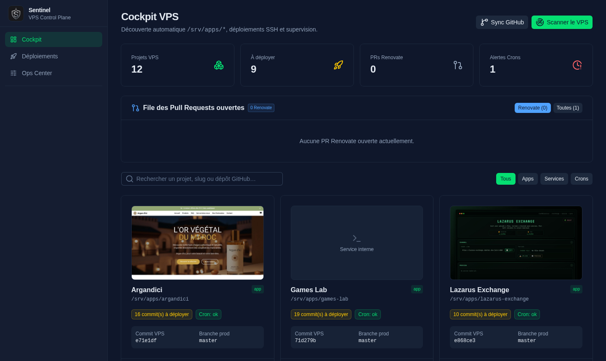

<a name="readme-top"></a>

<!-- PROJECT SHIELDS -->
[![Contributors][contributors-shield]][contributors-url]
[![Forks][forks-shield]][forks-url]
[![Stargazers][stars-shield]][stars-url]
[![Issues][issues-shield]][issues-url]
[![MIT License][license-shield]][license-url]
[![LinkedIn][linkedin-shield]][linkedin-url]

<!-- TABLE OF CONTENTS -->
<details>
  <summary>Table of Contents</summary>
  <ol>
    <li>
      <a href="#-about-the-project">About The Project</a>
      <ul>
        <li><a href="#ℹ️-description">Description</a></li>
        <li><a href="#-core-features">Core Features</a></li>
        <li><a href="#🏗️-built-with">Built With</a></li>
      </ul>
    </li>
    <li>
      <a href="#-getting-started">Getting Started</a>
      <ul>
        <li><a href="#-prerequisites">Prerequisites</a></li>
        <li><a href="#-installation">Installation</a></li>
        <li><a href="#-docker-compose">Docker Compose</a></li>
        <li><a href="#-first-login--vps-discovery">First Login &amp; VPS Discovery</a></li>
        <li><a href="#-environment-variables-reference">Environment Variables Reference</a></li>
      </ul>
    </li>
    <li>
      <a href="#-operational-contracts--architecture">Operational Contracts &amp; Architecture</a>
      <ul>
        <li><a href="#-sentineljson-manifest">sentinel.json Manifest</a></li>
        <li><a href="#-deploysh-contract">deploy.sh Contract</a></li>
        <li><a href="#-statussh--cron-statusjson-contract">status.sh &amp; cron-status.json Contract</a></li>
        <li><a href="#-prometheus-cron-metrics-metrics">Prometheus Cron Metrics (/metrics)</a></li>
        <li><a href="#-quick-terminal-security-model">Quick Terminal Security Model</a></li>
        <li><a href="#-zero-reload-maintenance-mode">Zero-Reload Maintenance Mode</a></li>
        <li><a href="#-grafana-embed--direct-sso">Grafana Embed &amp; Direct SSO</a></li>
        <li><a href="#-umami-analytics-v2-integration">Umami Analytics v2 Integration</a></li>
        <li><a href="#-apiflash-project-screenshots">ApiFlash Project Screenshots</a></li>
        <li><a href="#-authentik-oidc-single-sign-on">Authentik OIDC Single Sign-On</a></li>
        <li><a href="#-background-scheduler-croner">Background Scheduler (croner)</a></li>
      </ul>
    </li>
    <li><a href="#-cli--development-commands">CLI &amp; Development Commands</a></li>
    <li><a href="#-testing--quality-assurance">Testing &amp; Quality Assurance</a></li>
    <li><a href="#-contributing">Contributing</a></li>
    <li><a href="#-license">License</a></li>
    <li><a href="#-contact">Contact</a></li>
  </ol>
</details>

<!-- ABOUT THE PROJECT -->
# 🧠 About The Project

<p align="center">
  <a href="https://github.com/nlabrazi/sentinel">
    
  </a>
</p>

### ℹ️ Description

**Sentinel v2** is a self-hosted DevOps & VPS project operations control plane built with **Nuxt 4 (Nitro)**, **TypeScript**, **`@nuxt/ui` v4**, and **PostgreSQL 16 + Drizzle ORM**, designed to discover, operate, and deploy Docker-based projects running under `/srv/apps/*` on a VPS.

It is not built to duplicate Prometheus, Grafana, Loki, or raw SSH access. Rather, its mission is to centralize day-to-day VPS operations in a fast, type-safe interface:

- 🛰️ **Automatic VPS Discovery (`/srv/apps/*`)**: Scans your VPS over SSH (`ssh2`) to discover deployed directories, GitHub remotes, live `HEAD` commits, `deploy.sh` / `status.sh` contracts, `maintenance.on` flags, and optional `sentinel.json` manifests — zero manual seeding.
- 🔁 **Standardized Deployment Pipeline**: One-click deployments via SSH executing `/srv/apps/<slug>/deploy.sh` with PostgreSQL transactional locks (`SELECT FOR UPDATE`) and real-time Server-Sent Events (SSE) log streaming.
- 🧾 **Centralized Deployments Hub (`/deploys`)**: Global view of all deployments across projects with live KPIs, success rate, average duration, status/project filters, search, and expandable log viewer.
- 🔗 **GitHub Synchronization, Drift & Renovate Queue**: Tracks commits behind production, `staging` vs `production` drift with direct GitHub compare links, and aggregates all open **Renovate PRs** across your repositories.
- ⏱️ **Cron Supervision & Prometheus Export (`/metrics`)**: Evaluates UTC cron schedules (`cron-parser`) with overdue grace periods and exposes `sentinel_cron_*` gauges in Prometheus 0.0.4 format protected by a Bearer token.
- 💻 **Interactive Quick Terminal**: In-browser SSH diagnostic terminal with a strict server-side binary whitelist and secret-access guardrails.
- 🖼️ **Automated Project Screenshots**: Captures 16:9 website previews via **ApiFlash** (post-deploy or on demand) and stores them directly in PostgreSQL (`project_screenshots`) without external blob storage.
- 📈 **Umami Analytics v2**: 24-hour site traffic metrics (visitors, pageviews, visits, bounces) auto-matched by domain with background and on-demand sync.
- 📊 **Grafana Embed & Direct SSO**: Project-scoped Grafana dashboard iframes synced to light/dark mode plus a direct `/login/generic_oauth` SSO entry link sharing your Authentik session.
- 🛡️ **Zero-Reload Maintenance Mode**: Instant `maintenance.on` toggling on the VPS without reloading Nginx.
- 🔐 **Stateless Authentik OIDC Admin SSO**: PKCE S256 OpenID Connect login with AES-256-GCM encrypted `httpOnly` session cookies and admin group/email enforcement — no local passwords or user database.
- ⚙️ **Ops Control Center (`/settings`)**: Immediate global sync triggers, `croner` scheduler heartbeats, PostgreSQL health, and masked environment variable diagnostics.

---

## ⚡ Core Features

### 📦 1. Automatic VPS Discovery & Project Typology
- Automatically scans `/srv/apps/*` via SSH (`server/services/vps-discovery.ts`) to register and refresh projects without manual seeding.
- Supports Git repositories located at `/srv/apps/<slug>/.git` or `/srv/apps/<slug>/repo/.git` (including SSH deploy-key host aliases such as `git@github-<alias>:owner/repo.git`).
- Classifies workloads by kind:
  - `app`: Standard web applications with a public production URL, screenshots, Umami analytics, and GitHub tracking.
  - `service`: Background daemons, bots, or internal infrastructure stacks.
  - `cron`: Projects dedicated to scheduled batch jobs and probes.
- Optional `/srv/apps/<slug>/sentinel.json` manifest lets each project declare metadata (`name`, `kind`, `production_url`, `production_branch`, `staging_branch`, `grafana_app_value`, `cron_monitoring`).

### 🔁 2. Safe SSH Deployment Pipeline with Live SSE Logs
- Executes `/srv/apps/<slug>/deploy.sh` on the VPS over SSH (`ssh2`) with strict host-key verification.
- **PostgreSQL Transactional Locking**: Uses `SELECT ... FOR UPDATE` to guarantee at most one active deployment per project at any time.
- **Real-Time Log Streaming**: Streams live `stdout`/`stderr` chunks to the browser over SSE (`/api/deploys/:id/stream`) and persists logs safely truncated at 64 KB.
- Automatically refreshes the project's ApiFlash screenshot in the background after a successful deployment.

### 🧾 3. Centralized Deployments Hub (`/deploys`)
- Operational KPIs across the whole VPS: total deployments, success rate percentage, failed count, and average duration.
- Filter by project, status (`running`, `success`, `failed`), or full-text search on commit SHA and slug.
- Active live banner whenever a deployment is running, with expandable log drawer and 1-click clipboard copy.

### 🔗 4. GitHub Sync, Branch Drift & Renovate PR Queue
- Compares the live VPS `HEAD` commit SHA against `production_branch` and tracks `staging_branch` vs `production_branch` drift (`synced`, `ahead`, `behind`, `diverged`).
- Auto-enriches missing `production_url` and `grafana_app_value` from the GitHub repository's `homepage` field.
- Aggregates open Pull Requests across all projects with a dedicated **Renovate PR Queue** right on the cockpit dashboard.

### ⏱️ 5. Cron Job Supervision & Prometheus Exporter
- Parses status reported by `/srv/apps/<slug>/status.sh` or `/srv/apps/<slug>/sentinel/cron-status.json`.
- Evaluates standard 5-field UTC cron expressions via `cron-parser` (and handles `schedule: "manual"` probes cleanly without false alerts).
- Exposes `GET /metrics` in Prometheus 0.0.4 text format protected by a timing-safe Bearer token (`PROMETHEUS_METRICS_TOKEN`).

### 💻 6. Interactive Quick Terminal
- Embedded SSH diagnostic console on each project page rooted in `/srv/apps/<slug>`.
- Strictly validated server-side by `server/services/quick-command.ts` with a binary whitelist, forbidden metacharacters, secret file blocking, 10-second timeout, and 64 KB output cap.
- 1-click suggestion chips (`docker compose ps`, `git status`, `df -h`, `uptime`), command history, and copyable output.

### 🖼️ 7. Project Screenshots (ApiFlash + PostgreSQL)
- Captures 1280×720 JPEG previews via ApiFlash and stores them directly in PostgreSQL (`project_screenshots` table) — no Cloudinary or S3 dependency required.
- Displayed on cockpit project cards and in the project overview header with a **« Rafraîchir l'aperçu »** button and global capture triggers in `/settings`.

### 📈 8. Umami Analytics v2 Integration
- Supports Bearer JWT (`UMAMI_AUTH_TOKEN`), API Key (`UMAMI_API_KEY`), or service-account login (`UMAMI_USERNAME` / `UMAMI_PASSWORD`).
- Automatically matches websites by `production_url` hostname (normalizing `www.`) or explicit `umami_website_id`.
- Syncs 24-hour visitors, pageviews, visits, and bounce metrics on schedule (`*/15 * * * *`) and on demand.

### 📊 9. Grafana Embed & Direct Authentik SSO
- Embeds project-scoped Grafana dashboards synced with Sentinel's light/dark theme (`var-app=<grafana_app_value>`).
- Includes a **Grafana SSO** sidebar link targeting `<GRAFANA_BASE_URL>/login/generic_oauth` so your active Authentik session signs you straight into Grafana as Admin (bypassing Grafana Anonymous Viewer mode).

### 🔐 10. Stateless Authentik OIDC Admin Authentication
- Zero local password table: authenticates strictly via **Authentik OpenID Connect (PKCE S256)**.
- Enforces authorization against `AUTHENTIK_ALLOWED_GROUPS` (default: `authentik Admins`) and/or `AUTHENTIK_ALLOWED_EMAILS`.
- Stores sessions in AES-256-GCM encrypted `httpOnly` / `SameSite=Lax` cookies.
- Supports both `/auth/callback` and legacy `/users/auth/openid_connect/callback` redirect URIs.

### ⚙️ 11. Ops Control Center (`/settings`)
- Global triggers: Scan VPS, Sync GitHub, Sync Crons, Sync Umami, Capture Missing Screenshots, and Force Refresh All Screenshots.
- Live PostgreSQL connection status, runtime metrics, `croner` background scheduler heartbeats, and masked environment configuration audit.

---

### 🏗️ Built With

* [![Nuxt 4][Nuxt.js]][Nuxt-url]
* [![TypeScript][TypeScript.js]][TypeScript-url]
* [![Vue 3][Vue.js]][Vue-url]
* [![TailwindCSS][TailwindCSS.js]][TailwindCSS-url]
* [![PostgreSQL][PostgreSQL.js]][PostgreSQL-url]
* [![Drizzle ORM][Drizzle.js]][Drizzle-url]
* [![Docker][Docker.io]][Docker-url]
* [![Biome][Biome.js]][Biome-url]
* [![Vitest][Vitest.js]][Vitest-url]
* [![Playwright][Playwright.js]][Playwright-url]

<p align="right">(<a href="#readme-top">back to top</a>)</p>

---

<!-- GETTING STARTED -->
# ✅ Getting Started

Sentinel v2 runs on **Node.js 26** with **PostgreSQL 16** and ships with a ready-to-use development Docker Compose stack.

### 📋 Prerequisites

- **Node.js 26** (see `.nvmrc`)
- **Docker** & **Docker Compose**
- GitHub Packages authentication in `~/.npmrc` for `@nlabrazi/*` shared dev-platform packages (`@nlabrazi:registry=https://npm.pkg.github.com/`)

### 💻 Installation

```bash
# Clone the repository
git clone git@github.com:nlabrazi/sentinel.git
cd sentinel

# Copy the example environment variables file
cp .env.example .env

# Generate a strong SESSION_SECRET
node -e "console.log(require('node:crypto').randomBytes(32).toString('hex'))"
```

Review `.env` and fill in your `SESSION_SECRET`, `AUTHENTIK_*`, `VPS_HOST`, `GITHUB_TOKEN`, `APIFLASH_ACCESS_KEY`, `PROMETHEUS_METRICS_TOKEN`, `UMAMI_*`, and `GRAFANA_*` values, and place your VPS SSH key & `known_hosts` under `config/ssh_key/` (gitignored).

### 🐳 Docker Compose

```bash
# Start PostgreSQL 16 and the Nuxt 4 dev server (http://localhost:3000)
docker compose up --build

# Or start only PostgreSQL and run Nuxt natively on your host
docker compose up -d sentinel-db
npm ci
npm run db:migrate
npm run dev
```

Drizzle migrations under `server/db/migrations/` are automatically applied on Nitro startup outside `NODE_ENV=test`.

### 🔑 First Login & VPS Discovery

1. Navigate to `http://localhost:3000` — unauthenticated requests redirect to `/login`.
2. Click **« Se connecter avec Authentik »** to sign in with your Authentik administrator account (or set `AUTH_DEV_BYPASS=true` in local dev only; this flag is strictly ignored in `NODE_ENV=production`).
3. Click **« Scanner le VPS »** on the cockpit to discover all projects under `/srv/apps/*`, then **« Sync GitHub »** and **« Capturer les aperçus »** from `/settings`.

---

### 🔧 Environment Variables Reference

| Category | Variable | Description |
| :--- | :--- | :--- |
| **Core & Runtime** | `NODE_ENV` | Runtime mode (`development`, `test`, `production`). |
| | `PORT` | HTTP server listen port. Default: `3000`. |
| | `SESSION_SECRET` | Secret key (≥ 32 chars) used for AES-256-GCM session & OIDC cookie encryption. |
| | `AUTH_DEV_BYPASS` | Local/E2E auth bypass (`true`/`false`). **Strictly disabled when `NODE_ENV=production`.** Default: `false`. |
| **Database** | `DATABASE_URL` | Full PostgreSQL 16 connection URI (overrides `POSTGRES_*` variables when set). |
| | `POSTGRES_HOST` | PostgreSQL host (`sentinel-db` in Docker Compose). Default: `localhost`. |
| | `POSTGRES_USER` | PostgreSQL user. Default: `postgres`. |
| | `POSTGRES_PASSWORD` | PostgreSQL password. Default: `postgres`. |
| | `POSTGRES_DB` | PostgreSQL database name. Default: `sentinel_development`. |
| **Authentik SSO** | `AUTHENTIK_ENABLED` | Enable OpenID Connect login (`true`/`false`). Default: `true`. |
| | `AUTHENTIK_ISSUER` | Authentik OIDC Issuer URL (e.g. `https://auth.nabster.dev/application/o/sentinel/`). |
| | `AUTHENTIK_CLIENT_ID` | OAuth2 / OIDC Client ID from Authentik. |
| | `AUTHENTIK_CLIENT_SECRET` | OAuth2 / OIDC Client Secret from Authentik. |
| | `AUTHENTIK_REDIRECT_URI` | Callback URL (`/auth/callback` or legacy `/users/auth/openid_connect/callback`). |
| | `AUTHENTIK_ALLOWED_GROUPS` | Comma-separated Authentik groups granted admin access. Default: `authentik Admins`. |
| | `AUTHENTIK_ALLOWED_EMAILS` | Optional comma-separated allowlist of administrator emails. |
| **VPS / SSH** | `VPS_HOST` | Hostname or IP address of the target VPS. |
| | `VPS_USER` | SSH user on the VPS. Default: `control-panel`. |
| | `SSH_DEPLOY_AS_USER` | Optional Unix user to run `/srv/apps/<slug>/deploy.sh` via `sudo -n -H -u <user>` (requires a targeted `sudoers` rule). |
| | `VPS_APPS_ROOT` | Root directory scanned for deployed projects. Default: `/srv/apps`. |
| | `SSH_KEY_PATH` | Path to the SSH private key (`config/ssh_key/sentinel_control_panel`). |
| | `SSH_KNOWN_HOSTS_PATH` | Path to the SSH `known_hosts` file (`config/ssh_key/known_hosts`). |
| | `SSH_VERIFY_HOST_KEY` | Host key verification mode (`always`, `accept_new`, `never`). Default: `always`. |
| | `SSH_CONNECT_TIMEOUT_SECONDS` | SSH connection timeout in seconds. Default: `10`. |
| | `SSH_COMMAND_TIMEOUT_SECONDS` | Maximum execution timeout for `deploy.sh` in seconds. Default: `600`. |
| **GitHub** | `GITHUB_TOKEN` | GitHub Personal Access Token for commit drift, branch compare, and PR/Renovate sync. |
| **Screenshots** | `APIFLASH_ACCESS_KEY` | Optional ApiFlash API key for automated 16:9 project previews stored in PostgreSQL. |
| **Cron & Metrics** | `CRON_OVERDUE_GRACE_MINUTES` | Grace period in minutes before a missed UTC cron occurrence becomes `overdue`. Default: `15`. |
| | `CRON_SYNC_STALE_AFTER_MINUTES` | Threshold in minutes before cron sync is flagged stale. Default: `15`. |
| | `PROMETHEUS_METRICS_TOKEN` | Bearer token protecting `GET /metrics` (Prometheus 0.0.4 scrape endpoint). |
| **Umami Analytics** | `UMAMI_BASE_URL` | Self-hosted Umami instance URL (e.g. `https://umami.nabster.dev`). |
| | `UMAMI_AUTH_TOKEN` | Bearer JWT token for Umami v2 API. |
| | `UMAMI_API_KEY` | Optional Umami API key (`x-umami-api-key`). |
| | `UMAMI_USERNAME` | Dedicated Umami service account username (alternative login method). |
| | `UMAMI_PASSWORD` | Dedicated Umami service account password (alternative login method). |
| **Grafana Embed** | `GRAFANA_BASE_URL` | Base URL of your Grafana instance (e.g. `https://grafana.nabster.dev`). |
| | `GRAFANA_DASHBOARD_UID` | Target Grafana dashboard UID. |
| | `GRAFANA_DASHBOARD_SLUG` | Target Grafana dashboard slug. Default: `applications-overview`. |
| | `GRAFANA_VARIABLE_NAME` | Dashboard template variable name. Default: `app`. |
| | `GRAFANA_DEFAULT_THEME` | Default embed theme (`dark` / `light`). Default: `dark`. |
| | `GRAFANA_ORG_ID` | Grafana organization ID. Default: `1`. |
| | `GRAFANA_DEFAULT_FROM` | Default start window. Default: `now-6h`. |
| | `GRAFANA_DEFAULT_TO` | Default end window. Default: `now`. |
| | `GRAFANA_DEFAULT_TIMEZONE` | Default timezone. Default: `browser`. |
| | `GRAFANA_REFRESH` | Auto-refresh interval. Default: `30s`. |
| | `GRAFANA_PANEL_ID` | Target panel ID for solo panel preview. Default: `panel-6`. |
| | `GRAFANA_GLOBAL_VARIABLE_VALUE` | Fallback variable value when no project filter is set. Default: `All`. |

<p align="right">(<a href="#readme-top">back to top</a>)</p>

---

<!-- OPERATIONAL CONTRACTS -->
# 📜 Operational Contracts & Architecture

Sentinel standardizes how projects interact with your VPS through lightweight, stack-agnostic contracts.

### 🧩 sentinel.json Manifest

Projects under `/srv/apps/<slug>` are discovered automatically without any config file. Adding `/srv/apps/<slug>/sentinel.json` (or inside `/srv/apps/<slug>/repo/sentinel.json`) lets a project declare explicit metadata:

```json
{
  "name": "My App",
  "kind": "app",
  "production_url": "https://app.nabster.dev",
  "production_branch": "master",
  "staging_branch": "staging",
  "grafana_app_value": "https://app.nabster.dev",
  "cron_monitoring": true
}
```

### 📜 deploy.sh Contract

Each deployable project exposes an executable deployment script at:

```bash
/srv/apps/<project>/deploy.sh
```

**Contract Rules**:
- Executable by the configured VPS SSH user (`chmod +x deploy.sh`).
- Strictly non-interactive (must not prompt for input).
- Returns exit code `0` on success and non-zero on failure.
- Streams diagnostic messages to `stdout` and `stderr` (forwarded live over SSE and stored up to 64 KB).
- Keeps project-specific build/migration logic encapsulated inside the project itself.

#### Optional Least-Privilege Delegation (`SSH_DEPLOY_AS_USER`)

If your `/srv/apps/*/repo` directories are owned by another user (e.g. `zref`) while Sentinel connects over SSH as a dedicated read-only user (`sentinel`), set `SSH_DEPLOY_AS_USER=zref` and add a single scoped `sudoers` rule on the VPS (`/etc/sudoers.d/sentinel`):

```sudoers
sentinel ALL=(zref) NOPASSWD: /srv/apps/*/deploy.sh
```

Sentinel will execute `sudo -n -H -u zref /srv/apps/<slug>/deploy.sh`, keeping `sentinel` read-only everywhere else while preserving the target user's Git ownership and SSH deploy keys.

#### Recommended `deploy.sh` Template (Docker Compose)

```bash
#!/usr/bin/env bash
set -euo pipefail

echo "==> [$(date -u +%T)] Starting deployment..."

# 1. Update source code
git fetch origin master
git reset --hard origin/master

# 2. Pull and rebuild containers
docker compose pull
docker compose build --pull
docker compose up -d --remove-orphans

# 3. Clean up dangling images
docker image prune -f

echo "==> [$(date -u +%T)] Deployment finished successfully."
```

### 📡 status.sh & cron-status.json Contract

For projects running scheduled batch jobs, Sentinel inspects status published at `/srv/apps/<project>/sentinel/cron-status.json` or printed to `stdout` by `/srv/apps/<project>/status.sh`:

```json
{
  "version": 1,
  "jobs": [
    {
      "name": "daily-import",
      "command": "./bin/daily-import",
      "schedule": "0 2 * * *",
      "last_execution_at": "2026-11-21T02:00:12Z",
      "last_status": "success",
      "last_duration": 42,
      "last_log": "Import completed successfully"
    }
  ]
}
```

*(Legacy `cron_jobs` arrays, object maps, and `schedule: "manual"` probe entries are also supported; `ok`/`error` statuses normalize to `success`/`failed`.)*

### 📈 Prometheus Cron Metrics (`/metrics`)

Sentinel evaluates VPS cron schedules in UTC using `cron-parser`. `CRON_OVERDUE_GRACE_MINUTES` and `CRON_SYNC_STALE_AFTER_MINUTES` default to `15`. Set `PROMETHEUS_METRICS_TOKEN`, then scrape:

```bash
curl --fail -H "Authorization: Bearer $PROMETHEUS_METRICS_TOKEN" \
  https://sentinel.nabster.dev/metrics
```

The endpoint returns Prometheus text format `0.0.4` without an Authentik cookie. Missing, incorrect, or unconfigured tokens return `401` (query-string tokens are rejected). Only projects with `cron_monitoring_enabled = true` are exported:

| Metric prefix: `sentinel_cron_` | Meaning |
| :--- | :--- |
| `job_healthy` | `1` when the job needs no attention, otherwise `0` |
| `job_failed` | `1` when the last execution failed |
| `job_overdue` | `1` when an expected UTC occurrence was missed beyond the grace period |
| `job_last_execution_timestamp_seconds` | Last execution timestamp as Unix seconds |
| `job_last_duration_seconds` | Last execution duration in seconds |
| `project_last_sync_timestamp_seconds` | Last successful sync timestamp as Unix seconds |
| `project_sync_stale` | `1` when sync is missing or older than the stale threshold |
| `project_healthy` | `1` when all reported jobs are healthy and sync is recent |

Labels are strictly limited to `project` (slug) and, for job metrics, `job` (name).

### 💻 Quick Terminal Security Model

The interactive Quick Terminal connects to `/srv/apps/<slug>` over SSH and is constrained server-side by `server/services/quick-command.ts`:

- **Whitelisted Binaries**:
  `cat`, `head`, `tail`, `grep`, `egrep`, `fgrep`, `wc`, `find`, `ls`, `diff`, `stat`, `file`, `uptime`, `df`, `free`, `ps`, `pwd`, `date`, `whoami`, `uname`, `git`, `docker`, `docker-compose`, plus local `./*.sh` scripts inside the project directory.
- **Prohibited Patterns**:
  - Privilege escalation or destructive commands (`sudo`, `su`, `rm`, `chmod`, `chown`, `kill`, `reboot`).
  - Network utilities (`curl`, `wget`, `nc`, `telnet`).
  - Interpreters (`python`, `ruby`, `node`, `php`, `sh`, `bash`).
  - Chaining, pipes, redirections, and substitutions (`;`, `&&`, `||`, `|`, `>`, `<`, `\`, `` ` ``, `$()`).
  - Secret files or directory traversal (`.env`, `*.key`, `*.pem`, `id_rsa`, `sentinel_control_panel`, `credentials*.enc`, `..`).
- Hard-limited to a **10-second timeout** and **64 KB** output size.

### 🛡️ Zero-Reload Maintenance Mode

Sentinel creates or removes `/srv/apps/<project>/maintenance.on` over SSH so Nginx can immediately serve a `503` maintenance page without reloading:

```nginx
server {
    server_name myapp.nabster.dev;

    # Instant Sentinel maintenance detection
    if (-f /srv/apps/myapp/maintenance.on) {
        return 503;
    }

    error_page 503 @maintenance;
    location @maintenance {
        root /srv/apps/myapp/public;
        rewrite ^(.*)$ /503.html break;
    }

    location / {
        proxy_pass http://127.0.0.1:3000;
        proxy_set_header Host $host;
        proxy_set_header X-Real-IP $remote_addr;
    }
}
```

### 📊 Grafana Embed & Direct SSO

Sentinel embeds private Grafana dashboards inside an iframe without putting tokens in URLs, and provides a **Grafana SSO** entry button pointing to `<GRAFANA_BASE_URL>/login/generic_oauth` so your Authentik browser session immediately signs you into Grafana as Admin.

Recommended `grafana.ini` settings for seamless embedding:

```ini
[auth]
oauth_auto_login = true

[security]
allow_embedding = true
cookie_samesite = none
cookie_secure = true
```

### 📈 Umami Analytics v2 Integration

- Configure `UMAMI_BASE_URL` along with `UMAMI_AUTH_TOKEN`, `UMAMI_API_KEY`, or `UMAMI_USERNAME` / `UMAMI_PASSWORD`.
- Automatically resolves websites by comparing `production_url` hostnames (stripping `www.`) or via manual `umami_website_id`.
- Synchronizes 24-hour visitors, pageviews, visits, and bounce counts via `server/services/umami.ts`.

### 🖼️ ApiFlash Project Screenshots

- Set `APIFLASH_ACCESS_KEY` in `.env` to enable 1280×720 JPEG captures.
- Captured images are stored directly in PostgreSQL (`project_screenshots`) and served behind authentication at `GET /api/projects/:slug/screenshot?v=<epoch>`.
- Triggered automatically after successful deployments, per project from `/projects/:slug`, or globally via `/settings`.

### 🔐 Authentik OIDC Single Sign-On

- Stateless PKCE S256 OIDC implementation (`server/services/auth.ts`) — no local user passwords.
- Create an OpenID Connect Provider and Application in Authentik with scopes `openid`, `profile`, `email` (ensuring `groups` is included in claims).
- Supported Redirect URIs:
  - `https://sentinel.nabster.dev/auth/callback`
  - `https://sentinel.nabster.dev/users/auth/openid_connect/callback` (legacy compatibility)
- Restrict admin access via `AUTHENTIK_ALLOWED_GROUPS` and/or `AUTHENTIK_ALLOWED_EMAILS`.

### 🔄 Background Scheduler (`croner`)

Registered automatically via `server/plugins/scheduler.ts` (disabled in `NODE_ENV=test`) with live heartbeat tracking visible in `/settings`:

- `sync-github` (`*/5 * * * *`): Synchronizes commits, branch drift, and open/Renovate PRs.
- `sync-cron` (`*/5 * * * *`): Fetches VPS cron job statuses via `status.sh` / `cron-status.json`.
- `sync-umami` (`*/15 * * * *`): Refreshes 24-hour Umami analytics metrics.
- `scan-vps` (`*/30 * * * *`): Discovers new or updated projects under `/srv/apps/*`.

<p align="right">(<a href="#readme-top">back to top</a>)</p>

---

<!-- CLI & SCRIPTS -->
# 🧪 CLI & Development Commands

```bash
# Start full local stack (PostgreSQL 16 + Nuxt 4 dev server)
docker compose up --build

# Run Nuxt dev server on host (with sentinel-db running)
npm run dev

# Biome lint + format check / auto-fix (@nlabrazi/config-biome)
npm run check
npm run check:write

# TypeScript & Vue strict typechecking
npm run typecheck

# Generate & apply Drizzle PostgreSQL migrations
npm run db:generate
npm run db:migrate

# Unit tests & coverage (Vitest + @nlabrazi/config-vitest)
npm test
npm run test:coverage

# Production Nuxt + Nitro build
npm run build

# End-to-End tests (Playwright + @nlabrazi/config-playwright)
npm run test:e2e
npm run test:e2e:ui
npm run test:e2e:report
```

<p align="right">(<a href="#readme-top">back to top</a>)</p>

---

<!-- TESTING & QUALITY ASSURANCE -->
# 🛡️ Testing & Quality Assurance

Sentinel v2 enforces strict static checks, unit tests, and end-to-end browser verification using shared `@nlabrazi/dev-platform` configurations.

### 🔬 1. Unit Testing (Vitest)
Unit tests live under `tests/unit/` and cover every server domain service without network dependencies:
- **Authentication & Env (`auth.test.ts`)**: AES-256-GCM session crypto, PKCE S256 OIDC flow, admin group/email guard, public path allowlist, and production bypass lockdown.
- **VPS Discovery & SSH (`ssh-discovery.test.ts`)**: `/srv/apps/*` scan output parsing, deploy-key aliases, `sentinel.json` manifest parsing, and `known_hosts` verification.
- **Deployments & Security (`deploy.test.ts`, `quick-command.test.ts`, `maintenance.test.ts`)**: PostgreSQL concurrency locking, log truncation, Quick Terminal whitelist enforcement, and `maintenance.on` toggles.
- **Integrations & Metrics (`github.test.ts`, `cron-metrics.test.ts`, `umami.test.ts`, `grafana.test.ts`, `screenshot.test.ts`, `scheduler.test.ts`)**: Branch drift, Renovate PR detection, UTC Prometheus gauges, ApiFlash capture, and `croner` heartbeats.

```bash
npm test
npm run test:coverage
```

### 🎭 2. End-to-End Testing (Playwright)
Browser journeys under `tests/e2e/sentinel.spec.ts` run headless against the built Nitro server and PostgreSQL 16:
- Dedicated `/login` Authentik SSO entry screen and button href validation.
- Cockpit VPS dashboard KPIs, search, kind filters, and VPS scan trigger.
- Full navigation flow across Cockpit, Deployments Hub (`/deploys`), and Ops Control Center (`/settings`) asserting zero runtime `pageerror`s.
- Prometheus `GET /metrics` Bearer authentication (`401` vs `200` in `0.0.4` format) and typed API responses.

```bash
npm run build
npm run db:migrate
CI=true npm run test:e2e
```

### 🚀 3. Continuous Integration Pipeline (Jenkins + Renovate)
The pipeline in `Jenkinsfile` uses the `nabster-ci` shared library on an isolated `sentinel-ci` Docker network:
1. **Test DB**: Boots an ephemeral `postgres:16-alpine` container (`pg_isready -h 127.0.0.1`).
2. **CI, Unit Tests & Build (`node:26-bookworm-slim`)**: `npmCi()`, Biome `check`, `typecheck`, Vitest `test`, and Nuxt `build`.
3. **End-to-End Tests (`mcr.microsoft.com/playwright:v1.63.0-noble`)**: Runs Drizzle migrations and Playwright E2E against the built server.
4. **Docker Production Build**: Verifies the multi-stage production image via `dockerBuildWithPackages(target: 'prod')`.
5. **Cleanup & Notifications**: Tears down ephemeral containers and notifies via `notifyTelegram`.

Dependency updates are automated via **Renovate** (`renovate.json`) targeting `staging`.

<p align="right">(<a href="#readme-top">back to top</a>)</p>

---

<!-- CONTRIBUTING -->
# 🙌 Contributing

Contributions are welcome! Please follow these steps:

1. 🍴 Fork the repository
2. 🔧 Create a feature branch from `staging` (`git checkout -b feat/my-feature`)
3. 💬 Commit your changes using Conventional Commits (`git commit -m "feat: add my feature"`)
4. 🚀 Push to your fork (`git push origin feat/my-feature`)
5. 📬 Open a Pull Request targeting `staging`

Please ensure that `npm run check`, `npm run typecheck`, `npm test`, and `npm run test:e2e` pass before opening a pull request.

<p align="right">(<a href="#readme-top">back to top</a>)</p>

---

<!-- LICENSE -->
### 📄 License

Distributed under the MIT License. See [LICENSE](./LICENSE) for more information.

<p align="right">(<a href="#readme-top">back to top</a>)</p>

---

<!-- CONTACT -->
### 📬 Contact

- 👤 [LinkedIn][linkedin-url]
- 🐦 [@Nabil](https://twitter.com/Nabil71405502)
- 📧 na.labrazi@gmail.com
- 🔗 [Portfolio](https://www.nabster.dev)
- 📁 [Project Repository](https://github.com/nlabrazi/sentinel)

<p align="right">(<a href="#readme-top">back to top</a>)</p>

<!-- MARKDOWN LINKS & IMAGES -->
[contributors-shield]: https://img.shields.io/github/contributors/nlabrazi/sentinel.svg?style=for-the-badge
[contributors-url]: https://github.com/nlabrazi/sentinel/graphs/contributors
[forks-shield]: https://img.shields.io/github/forks/nlabrazi/sentinel.svg?style=for-the-badge
[forks-url]: https://github.com/nlabrazi/sentinel/network/members
[stars-shield]: https://img.shields.io/github/stars/nlabrazi/sentinel.svg?style=for-the-badge
[stars-url]: https://github.com/nlabrazi/sentinel/stargazers
[issues-shield]: https://img.shields.io/github/issues/nlabrazi/sentinel.svg?style=for-the-badge
[issues-url]: https://github.com/nlabrazi/sentinel/issues
[license-shield]: https://img.shields.io/github/license/nlabrazi/sentinel.svg?style=for-the-badge
[license-url]: https://github.com/nlabrazi/sentinel/blob/master/LICENSE
[linkedin-shield]: https://img.shields.io/badge/-LinkedIn-black.svg?style=for-the-badge&logo=linkedin&colorB=555
[linkedin-url]: https://linkedin.com/in/nabil-labrazi
[Nuxt.js]: https://img.shields.io/badge/Nuxt%204-00DC82?style=for-the-badge&logo=nuxtdotjs&logoColor=white
[Nuxt-url]: https://nuxt.com/
[TypeScript.js]: https://img.shields.io/badge/TypeScript-3178C6?style=for-the-badge&logo=typescript&logoColor=white
[TypeScript-url]: https://www.typescriptlang.org/
[Vue.js]: https://img.shields.io/badge/Vue%203-4FC08D?style=for-the-badge&logo=vuedotjs&logoColor=white
[Vue-url]: https://vuejs.org/
[TailwindCSS.js]: https://img.shields.io/badge/TailwindCSS-06B6D4?style=for-the-badge&logo=tailwindcss&logoColor=white
[TailwindCSS-url]: https://tailwindcss.com/
[PostgreSQL.js]: https://img.shields.io/badge/PostgreSQL-316192?style=for-the-badge&logo=postgresql&logoColor=white
[PostgreSQL-url]: https://www.postgresql.org/
[Drizzle.js]: https://img.shields.io/badge/Drizzle%20ORM-C5F74F?style=for-the-badge&logo=drizzle&logoColor=black
[Drizzle-url]: https://orm.drizzle.team/
[Docker.io]: https://img.shields.io/badge/Docker-2496ED?style=for-the-badge&logo=docker&logoColor=white
[Docker-url]: https://www.docker.com/
[Biome.js]: https://img.shields.io/badge/Biome-60A5FA?style=for-the-badge&logo=biome&logoColor=white
[Biome-url]: https://biomejs.dev/
[Vitest.js]: https://img.shields.io/badge/Vitest-6E9F18?style=for-the-badge&logo=vitest&logoColor=white
[Vitest-url]: https://vitest.dev/
[Playwright.js]: https://img.shields.io/badge/Playwright-2EAD33?style=for-the-badge&logo=playwright&logoColor=white
[Playwright-url]: https://playwright.dev/
